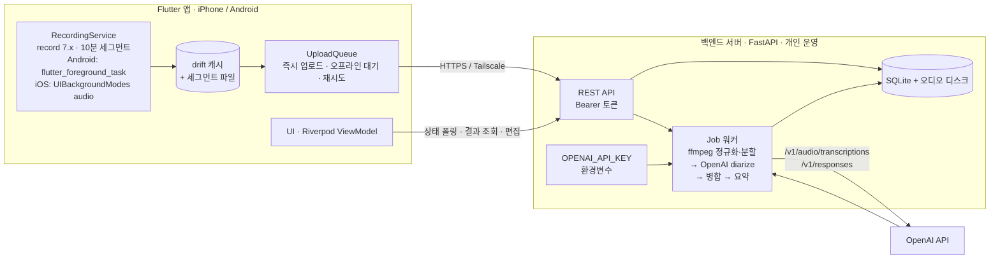

# 회의 녹음·전사 앱 기획서 (v0.3)

작성일: 2026-10-20 · 갱신: 2026-10-25 · 상태: v0.3 (에이닷 노트 기능 반영) · 대상: pseudo-lab-13 첫 번째 앱

변경 이력
- v0.1: 앱이 OpenAI를 직접 호출하는 단독 구조.
- v0.2: **별도 백엔드 서버**가 OpenAI 키와 전사·요약 파이프라인을 담당하는 구조로 전환. 앱스토어 배포 없음, 개인용 폰 설치.
- v0.3 (2026-10-25): 에이닷 노트 기능 반영. 실시간 받아쓰기·실시간 요약(서버 중계), 템플릿 4종, AI 질문(웹 검색), 파일 가져오기, 편집, 폴더, 선택 공유(PDF·녹음 파일), 자동 참조 음성으로 화자 일관성. 상세는 [05-anote-features.md](05-anote-features.md). 실시간 자막은 v0.2 이후 항목에서 MVP로 당겨졌고, 앱 직결 대신 서버 중계로 바뀌었다(05 문서 2.1).

## 0. 한 줄 정의

대면(오프라인) 회의를 폰으로 녹음해 개인 백엔드 서버로 올리면, 서버가 OpenAI STT로 **화자가 구분된 회의록**과
**요약·액션아이템**을 만들어 앱으로 돌려주는 시스템. Flutter 앱(iPhone + Android) + FastAPI 백엔드.

## 1. 확정된 결정과 전제

| 항목 | 결정 | 근거 |
|---|---|---|
| 배포 형태 | 앱스토어 아님. 본인 폰에 개인용 설치(iPhone은 TestFlight, Android는 APK 직접 설치) | 2026-10-20 확인 |
| 사용자 | 본인 1명 | 계정 체계·결제·심사 불필요 |
| 앱 플랫폼 | Flutter 단일 코드베이스 → Android APK + iOS IPA | 테스트 폰은 iPhone, APK도 원함 |
| 백엔드 | **별도 서버**. Python 3.12 + FastAPI(가정). OpenAI 키 보관, 전사·요약 파이프라인, 결과 저장 | 사용자 결정. 키가 폰에 남지 않고, 긴 오디오 처리를 서버가 맡음 |
| STT | OpenAI `gpt-4o-transcribe-diarize` (서버가 파일 업로드) | 화자 분리를 제공하는 유일한 OpenAI 모델 |
| 요약 | OpenAI 저가 텍스트 모델(`gpt-5-mini` 기본) | 전사 비용 대비 무시할 수준 |
| MVP 범위 | 녹음 + 업로드 + 전사 + 화자 분리 + 요약 + 조회 | 사용자 선택 |
| 참석자 | 보통 2~4명 | 참석자 음성 등록(최대 4명)으로 화자 일관성 해결 |
| 기기·환경 | Mac 없음, Apple 개발자 계정 없음, Android 실기기 없음, 개발 머신은 WSL2(에뮬레이터도 WSL2 내부 KVM) | 7장 |
| 네트워크 | 녹음은 오프라인 가능. 업로드·전사·요약은 서버 연결 필요 | 앱에 업로드 대기열을 둬서 흡수 |

> **주의: "APK"와 "아이폰"은 양립하지 않는다.** APK는 Android 전용이다. iPhone에는 macOS + Xcode로 빌드한 IPA만
> 설치되며 현재 WSL2에서는 빌드할 수 없다. Flutter로 코드는 하나지만 iOS 빌드는 Codemagic + Apple Developer 계정
> ($99/년) + TestFlight 경로가 필요하다. 7.3 참고.

## 2. 사용자 시나리오

1. **회의 전**: 앱 실행 → 제목 입력(선택) → (선택) 참석자 음성 등록 5초씩, 최대 4명 → 녹음 시작.
2. **회의 중**: 화면을 잠궈도 녹음 유지. 10분마다 세그먼트가 닫히고 **바로 서버로 업로드**되어 전사가 시작된다.
   경과 시간, 입력 레벨, 북마크 버튼.
3. **회의 후**: 정지 → 마지막 세그먼트 업로드 → 서버가 병합·요약 → 앱이 진행률을 폴링 → 완료.
   회의 중에 이미 대부분 전사가 끝나 있으므로 종료 후 수 분 안에 결과가 나온다.
4. **결과 확인**: 화자별 발화 타임라인 → 라벨(A, B)을 이름으로 변경 → 요약/결정사항/액션아이템 → 마크다운 공유 → 검색.
5. **서버 미연결 상황**(지하, 집 PC 꺼짐 등): 세그먼트는 폰에 남고 업로드 대기열에 쌓인다. 연결되면 자동 재개.

## 3. 기능 범위

### MVP (v0.1 릴리스)

앱
- 녹음: 백그라운드 유지, 10분 세그먼트 자동 분할, 인터럽션(전화) 시 세그먼트 저장 후 재시작.
- 업로드 대기열: 세그먼트 완료 즉시 업로드, 실패·오프라인 시 재시도, 앱 재시작 후 재개.
- 참석자 음성 등록: 이름 + 5초 녹음 → 서버 전송.
- 조회: 회의 목록, 진행률, 화자별 전사, 요약, 검색(서버 검색 API).
- 편집·공유: 화자 이름 변경, 텍스트 수정, 마크다운/텍스트 공유.
- 설정: 서버 주소, 접근 토큰, 세그먼트 길이, 비트레이트.

백엔드
- 인증: 단일 Bearer 토큰(개인용), HTTPS 또는 Tailscale 사설망.
- 업로드 API: 회의 생성, 세그먼트 수신, 참석자 레퍼런스 수신, 종료 신호.
- 파이프라인: ffmpeg 정규화·분할 → OpenAI diarize 전사 → 오프셋 병합 → 요약(JSON schema) → 저장.
- 조회 API: 상태·진행률, 전사, 요약, 목록·검색, 화자 이름 변경, 마크다운 내보내기.
- 저장: SQLite + 로컬 디스크(오디오). 백업은 디렉터리 단위 rsync로 충분.

### v0.2 이후

- 실시간 자막: 서버가 `POST /v1/realtime/client_secrets`로 임시 비밀 발급 → 앱이 `gpt-live-transcribe`에 WebSocket 직결(화자 없음).
- 웹 뷰어: 같은 백엔드를 브라우저에서 조회·편집. PC에서 회의록을 보는 용도.
- 5명 이상 회의의 화자 수동 병합 UI, 캘린더 연동, 푸시 알림(완료 시).

### MVP에서 하지 않는 것

- 온디바이스 STT, 다중 사용자·계정, 앱스토어 심사 대응, 영상, 회의 중 번역.

## 4. 아키텍처

### 4.1 책임 분리

| 영역 | 앱 | 서버 |
|---|---|---|
| 오디오 | 녹음, 세그먼트 분할, 임시 보관 | 정규화(mono 16kHz), 25MB 초과 시 무음 기준 재분할, 레퍼런스 클립 추출 |
| OpenAI | 호출하지 않음 | 전사, 요약. 키 보관, 재시도, 비용 로그 |
| 데이터 | 캐시 + 업로드 대기열 | **원본 저장소**(source of truth) |
| 상태 | 진행률 표시 | 상태 머신 관리 |
| 편집 | UI | 저장·검색 |

### 4.2 서버 데이터 모델

| 테이블 | 주요 필드 |
|---|---|
| `meetings` | id, title, created_at, duration_sec, **expected_segments**(finish 시 앱이 알려주는 세그먼트 수), status(recording/processing/merging/summarizing/done/failed), failed_step, error |
| `segments` | id, meeting_id, index, file_path(`{segment_id}.{ext}`, 요청마다 고유), start_offset_sec, duration_sec, status(received/normalizing/transcribing/done/failed), retry_count, openai_request_id, created_at, updated_at |
| `speakers` | id, meeting_id, raw_label(A/B), display_name, reference_clip_path |
| `utterances` | id, meeting_id, speaker_id, start_sec, end_sec, text, segment_id |
| `summaries` | meeting_id, json, model, prompt_version, created_at |
| `bookmarks` | id, meeting_id, at_sec, note |
| `usage_log` | id, meeting_id, model, audio_sec, tokens_in, tokens_out, cost_usd, created_at |

앱 로컬(drift): `pending_uploads`(세그먼트 파일, 상태), `meetings_cache`(목록·상세 캐시).

### 4.3 API 초안

| 메서드 | 경로 | 역할 |
|---|---|---|
| POST | `/meetings` | 회의 생성 → id |
| POST | `/meetings/{id}/speakers` | 참석자 이름 + 레퍼런스 클립(multipart) |
| POST | `/meetings/{id}/segments` | 세그먼트 업로드(multipart: index, start_offset_sec, duration_sec?, file) → 202. **같은 index 재업로드는 200 + 기존 레코드(멱등 재시도)**. status가 recording/processing일 때만 수용, index ≥ expected_segments면 409 |
| POST | `/meetings/{id}/finish` | 녹음 종료 신호 `{segment_count(필수), duration_sec?}` → status processing. **finish 뒤에 도착하는 세그먼트도 수용**(오프라인 대기열 대비). 세그먼트 done 수가 expected_segments와 같아지면 워커가 merging으로 전이 |
| GET | `/meetings/{id}` | 상태, 진행률(n/m 세그먼트), 소요 비용 |
| GET | `/meetings/{id}/transcript` | 화자별 발화 목록 |
| GET | `/meetings/{id}/summary` | 요약 JSON |
| PATCH | `/meetings/{id}/speakers/{sid}` | 화자 이름 변경 |
| PATCH | `/meetings/{id}/utterances/{uid}` | 텍스트 수정 |
| GET | `/meetings?q=` | 목록·검색(SQLite FTS5) |
| GET | `/meetings/{id}/export.md` | 마크다운 내보내기 |
| GET | `/health` | 헬스체크 |

인증은 모든 요청에 `Authorization: Bearer <token>`. 토큰은 서버 환경변수와 앱 보안 저장소에 각각 보관.
오류 응답은 모두 `{"detail": {"code": "...", "message": "..."}}` 형태로 통일한다(`not_found`, `meeting_closed`, `index_out_of_range`, `meeting_not_recording`, `speaker_limit` 등). 앱은 `code`로 분기한다.
인증과 업로드 크기 제한은 FastAPI가 multipart 본문을 파싱하기 **전에** ASGI 미들웨어에서 처리한다(토큰 없는 대용량 업로드가 디스크를 채우는 일을 막기 위해). `/docs`는 기본 비활성.

### 4.4 파이프라인 상태 머신 (서버)

세그먼트: `received → normalizing → transcribing → done | failed(retry ≤ 3)`
회의: `recording → processing(세그먼트 진행 중) → merging → summarizing → done | failed(step, reason)`
- 세그먼트 수용 구간은 `recording`과 `processing`이다. `finish`는 녹음이 끝났다는 신호와 `expected_segments`만 전달하고, 세그먼트가 늦게 도착해도 받는다.
- `processing → merging` 전이는 워커가 `done` 세그먼트 수 == `expected_segments`를 확인했을 때만 일어난다. 그 뒤로 오는 세그먼트는 `meeting_closed`로 거절한다.
워커는 단일 프로세스 + SQLite Job 테이블로 시작한다(개인용이라 동시성 요구가 낮다). 서버 재시작 시 `transcribing` 상태를 `received`로 되돌려 재개한다.

## 5. 핵심 기술 결정

### 5.1 긴 녹음 처리: 앱 세그먼트 + 서버 ffmpeg

OpenAI 파일 엔드포인트는 파일당 25MB가 상한이다.

| 인코딩 | 10분 | 60분 | 120분 |
|---|---|---|---|
| AAC-LC mono 32kbps | 2.4MB | 14.4MB | 28.8MB |
| AAC-LC mono 48kbps | 3.6MB | 21.6MB | 43.2MB |
| AAC-LC mono 64kbps | 4.8MB | 28.8MB | 57.6MB |

- 앱은 **10분 세그먼트, AAC-LC mono 48kbps m4a**로 녹음한다. 목적은 25MB 회피보다 **크래시 안전성과 회의 중 점진 업로드**다.
- 서버는 받은 파일을 ffmpeg로 mono 16kHz로 정규화하고, 25MB를 넘거나 길이가 과하면 `silencedetect` 기준으로 재분할한다.
  ffmpeg는 서버 CLI이므로 앱에 GPL 바이너리를 넣을 필요가 없다(v0.1의 `ffmpeg_kit_flutter_new` 고민이 사라짐).
- 세그먼트 경계 갭: 녹음기 정지·재시작 사이 수십~수백 ms. W1에서 측정하고, 문제가 되면 PCM 스트림 → WAV 청크 기록 방식으로 전환한다.
- 30초 넘는 오디오는 `chunking_strategy: "auto"` 필수. 서버 내부 VAD 분할이며 25MB 제한을 풀어주지는 않는다.

### 5.2 화자 분리 일관성

- diarize 모델의 라벨(A, B, …)은 **요청마다 새로 매겨진다**. 세그먼트 1의 A와 세그먼트 2의 A는 다른 사람일 수 있다.
- 해법: 회의 전 **참석자 음성 등록**(각 2~10초, 최대 4명). 서버가 ffmpeg로 클립을 정규화해 모든 세그먼트 요청에
  `known_speaker_names[]` + `known_speaker_references[]`(data URL)로 넣는다 → 라벨이 바로 이름으로 나온다.
- 등록 없이 녹음한 경우: 첫 세그먼트에서 각 라벨의 가장 긴 발화 구간을 ffmpeg로 잘라 **서버가 자동으로 레퍼런스를 만들고**
  이후 세그먼트에 사용한다. 사용자는 나중에 A/B에 이름만 붙인다. 서버에 ffmpeg가 있어 가능해진 설계다.
- 참석자가 5명 이상이면 레퍼런스 4명 + 나머지는 라벨 유지. 수동 병합 UI는 v0.2.
- diarize 모델은 `prompt`를 받지 않아 도메인 용어 힌트를 줄 수 없다. 용어 교정은 요약 프롬프트에서 처리.

### 5.3 보안과 키 관리

- OpenAI 키는 **서버 환경변수에만** 존재한다. 앱에는 서버 주소와 접근 토큰만 있다(`flutter_secure_storage`).
- 서버 노출 방식 두 가지. **MVP는 A를 권장**한다.
  - A. **Tailscale 사설망**: 서버와 폰을 같은 tailnet에 넣고 공개 포트를 열지 않는다. HTTPS는 Tailscale이 제공(`tailscale serve`). 비용 0, 노출 0.
  - B. **공개 VPS + Caddy HTTPS**: 어디서나 접속되지만 토큰 유출 시 비용 피해 가능. 공개 시 요청 크기 제한과 IP 레이트리밋 추가.
- OpenAI 대시보드에서 키별 **월 사용 한도**를 반드시 설정한다. `usage_log`로 회의별 비용을 기록한다.
- 실시간 자막(v0.2)은 서버가 임시 비밀을 발급하는 공식 패턴을 따른다.

### 5.4 요약 설계 (서버)

- 입력: 병합된 화자별 전사(60분 한국어 회의 ≈ 2~3만 토큰). 출력: Responses API + JSON schema 강제.
- 스키마: `summary`(3~5문장), `decisions[]`, `action_items[{what, who, due}]`, `topics[]`, `open_questions[]`.
- 모델: `gpt-5-mini` 기본, 비용 최소화 시 `gpt-5-nano`. `prompt_version`을 저장해 프롬프트 개선 후 재요약이 가능하게 한다.

### 5.5 플랫폼별 백그라운드 녹음 (앱)

| 플랫폼 | 필수 설정 | 제약 |
|---|---|---|
| Android | `RECORD_AUDIO`, `FOREGROUND_SERVICE`, `FOREGROUND_SERVICE_MICROPHONE`, `POST_NOTIFICATIONS`(13+), `foregroundServiceType="microphone"` | 마이크 포그라운드 서비스는 **앱이 화면에 있을 때 사용자 탭으로만 시작** 가능 |
| iOS | `NSMicrophoneUsageDescription`, `UIBackgroundModes: audio`, AVAudioSession `playAndRecord` | 전화·Siri 인터럽션 시 세션 종료 → 세그먼트 저장 후 재시작 필수. 실기기 2시간 테스트 전까지 미검증 |

앱 패키지: `record` 7.x, `flutter_foreground_task`, `drift`, `path_provider`, `flutter_secure_storage`, `dio` 또는 `http`(multipart 업로드·재시도), `flutter_riverpod`. `flutter_sound`는 유지보수 약화와 GPL 후속 버전 때문에 제외.
서버 스택: Python 3.12, FastAPI, SQLAlchemy + SQLite(FTS5), `openai` 공식 Python SDK, ffmpeg CLI, Docker 이미지로 고정.

## 6. 비용 추정 (OpenAI 공식 가격, 2026-10 기준)

| 항목 | 단가 | 60분 회의 | 120분 회의 |
|---|---|---|---|
| 전사 + 화자 분리 (`gpt-4o-transcribe-diarize`) | $0.006/분 | $0.36 | $0.72 |
| 요약 (`gpt-5-mini`) | $0.25/1M in, $2/1M out | ≈ $0.01 | ≈ $0.02 |
| **회의당 합계** | | **≈ $0.37** | **≈ $0.74** |
| (v0.2) 실시간 자막 `gpt-live-transcribe` | $0.017/분 | +$1.02 | +$2.04 |

고정비
- 서버: 집 PC/WSL2 + Tailscale이면 $0. 소형 VPS면 월 $4~6.
- iPhone 설치: Apple Developer Program $99/년. 다른 스택으로 바꿔도 동일.
- 월 20회 × 60분 기준 OpenAI 약 $7.4.

## 7. 개발 환경과 빌드·배포

### 7.1 현재 상태 (WSL2 Ubuntu)

W0(2026-10-21) 기준 WSL2에 **Flutter 3.47.7 stable(~/development/flutter)**, **Temurin JDK 21(~/development/jdk-21)**,
**Android SDK(platforms 35·36, build-tools 36.0.0, platform-tools 37.0.1, NDK 28.2, emulator 37.2.12, android-36 google_apis 이미지, ~/Android/Sdk)** 를 설치했다.
Python 3.12 · uv · ffmpeg · Docker는 이미 있었다. PATH는 `~/.flutter-android-toolchain.sh`(`~/.zshrc`·`~/.bashrc`가 source)가 잡아준다.
sudo 비밀번호는 없지만 `wsl.exe -u root -- <명령>`으로 루트 작업이 가능하다.
`flutter doctor`는 Flutter·Android toolchain 녹색, Linux desktop toolchain 빨강(의도적으로 무시). 디버그 APK 빌드·에뮬레이터 실행·백엔드 접속까지 확인했다.
**아직 없는 것**: Tailscale, Apple Developer 계정, gh CLI, GitHub 원격.
주 개발 루프는 **WSL2 내부 Android 에뮬레이터**, iPhone은 TestFlight로만 검증한다.

### 7.2 Android 개발 루프 (확정: WSL2 내부 KVM 에뮬레이터)

빌드·adb·에뮬레이터·백엔드가 **모두 WSL2 안**에서 돈다. 상세와 검증 기록은 [02-w0-windows-emulator-setup.md](02-w0-windows-emulator-setup.md).

- WSL2는 중첩 가상화로 `/dev/kvm`을 제공한다. Linux용 emulator 37.2.12 + AVD `pixel_api36`(API 36, RAM 2GB, 소프트웨어 GPU)가 약 75초에 콜드 부팅한다. 창은 WSLg로 Windows 바탕화면에 뜬다.
- 실행: `emu`(헬퍼) → `flutter run -d emulator-5554`. adb 서버는 WSL 로컬이라 Windows 브리지가 필요 없다.
- 에뮬레이터에서 WSL 백엔드는 `http://10.0.2.2:8000`으로 바로 닿는다(검증 완료). portproxy·mirrored 네트워킹 불필요.
- 마이크: WSLg PulseAudio가 Windows 마이크를 넘긴다. Extended controls → Microphone → "Virtual microphone uses host audio input". **실제 입력은 W1 녹음 스파이크에서 확인.**
  녹음·업로드·전사 기능 검증은 가능하지만 **화면 잠금·장시간 녹음 신뢰성은 에뮬레이터로 검증할 수 없다** → iPhone TestFlight에서 검증.
- Windows 쪽 에뮬레이터(Android Studio, WHPX)는 이 PC(Windows 11 26H2)에서 게스트가 실행되지 않아 **사용하지 않는다**. 원인 조사와 남겨 둔 브리지 헬퍼는 02 문서 3장.
- 메모리: 호스트 15.7GB. `.wslconfig`에 `memory=8GB`, `autoMemoryReclaim=gradual` 설정(다음 WSL 재시작 후 적용).

### 7.3 iPhone 경로

- 로컬 iOS 빌드·실행은 불가(macOS + Xcode 필요).
- 유일한 경로: **Codemagic 개인 계정 무료 500분/월(M2)** 로 빌드·서명 → **Apple Developer Program($99/년)** → **TestFlight**로 iPhone 설치. Mac 없이 가능.
- 무료 Apple ID 7일 사이드로드는 Mac이 필요해 WSL 환경에선 불가.
- iOS 테스트 사이클은 CI 왕복(약 15~25분) 단위다. 개발 루프는 Android에서 돌리고, iOS는 마일스톤마다 TestFlight로 검증한다.
- 결제 시점 권장: W0는 에뮬레이터로 진행하고 **W1 시작 시 가입**해 1순위 리스크(iPhone 화면 잠금 2시간 녹음)를 조기 검증한다.
- TestFlight 빌드는 90일 후 만료되므로 주기적으로 재빌드한다. 개인용이므로 App Store 심사는 없다.

### 7.4 백엔드 실행·배포

- 개발: WSL2에서 `uvicorn` 직접 실행. ffmpeg는 `apt install ffmpeg`.
- 운영(MVP): 같은 WSL2 또는 집 PC에서 Docker Compose로 상시 실행 + Tailscale. PC가 꺼져 있으면 앱 대기열이 흡수한다.
- 운영(선택): 소형 VPS로 이전. Docker 이미지가 같으므로 이전 비용이 낮다.
- 데이터: `data/` 디렉터리(SQLite + 오디오)를 주기적으로 rsync 백업.

### 7.5 CI

- Codemagic `codemagic.yaml` 하나로 Android APK + iOS IPA 빌드. 서명 키와 App Store Connect API 키는 Codemagic 환경변수에 보관.
- 월 500분 예산: iOS 빌드 1회 약 15~20분 → 월 25회 내외. 태그·수동 트리거로 제한.
- 백엔드는 GitHub Actions(무료)에서 테스트 + Docker 이미지 빌드.

## 8. 로드맵 (주 단위, 1인 기준)

| 주 | 목표 | 완료 기준 |
|---|---|---|
| W0 | 환경 구축, 양쪽 스캐폴드, CI | WSL2 `flutter doctor` 통과, Windows 에뮬레이터에서 Hello World(adb 브리지 검증), FastAPI `/health` + 토큰 인증, GitHub 저장소 + Codemagic Android 빌드 성공 |
| W1 | Apple 가입, 녹음 코어, 업로드 API | Apple Developer 가입 → TestFlight 첫 설치, 10분 세그먼트 녹음, 인터럽션 복구, 업로드 대기열, 서버 세그먼트 수신·저장, **iPhone 화면 잠금 2시간 녹음 스파이크**, 세그먼트 갭 측정 |
| W2 | 서버 전사 파이프라인 | ffmpeg 정규화·재분할, diarize 호출, 오프셋 병합, 재시도, 서버 재시작 재개, 상태 API, 앱 진행률 UI |
| W3 | 요약 + 결과 화면 + 공유 | JSON 요약, 화자 이름 변경, 텍스트 수정, FTS5 검색, 마크다운 내보내기·공유 |
| W4 | 참석자 등록, 배포, 실전 검증 | 참석자 음성 등록 → 레퍼런스 적용, 자동 레퍼런스 추출, Tailscale 운영 배포, 실제 회의 3건 end-to-end, 비용 로그 확인 |
| 이후 | v0.2: 실시간 자막, 웹 뷰어 | 별도 기획 |

## 9. 리스크와 검증 스파이크

| # | 리스크 | 영향 | 검증 방법 / 완화 |
|---|---|---|---|
| 1 | iPhone 화면 잠금 중 장시간 녹음 실패 | 제품 핵심 기능 불가 | W1 사이드로드 설치로 2시간 녹음 스파이크. 실시간 모드(PCM 스트림)와 일반 모드(AAC 파일)를 각각 확인. 실패 시 화면 켜둔 상태 운영 또는 네이티브 보강. 우회: 음성 메모로 녹음 후 ‘파일 가져오기’ |
| 2 | 세그먼트 경계 갭으로 문장 끊김 | 전사 품질 저하 | 실시간 모드는 PCM 스트림 → WAV 청크라 갭 없음(2026-10-25 구현). 일반(AAC) 모드는 여전히 측정 필요 |
| 3 | 한국어 화자 분리 정확도 미검증 | 회의록 신뢰도 | 실제 회의 1건으로 평가. 참석자 등록 유무 비교 |
| 4 | diarize 모델의 요청당 최대 길이 미공개 | 서버 분할 기준 | 10/15/20분 파일로 직접 테스트 |
| 5 | 저비트레이트에서 한국어 정확도 하락 | 비용·용량 vs 품질 | 32/48/64kbps 동일 음원 비교 |
| 6 | 서버 토큰 유출로 OpenAI 비용 폭주 | 금전 피해 | Tailscale 비공개 운영, 키 월 한도, usage_log 알림 |
| 7 | 서버가 꺼져 있을 때 회의 종료 | 결과 지연 | 앱 업로드 대기열 + 자동 재개. 상시 운영 원하면 VPS 이전 |
| 8 | Codemagic 무료 분 소진 | iOS 검증 지연 | 수동 트리거, Android 우선 개발 |
| 9 | Android 마이크 서비스는 백그라운드 시작 불가 | 예약 녹음 불가 | MVP는 사용자 탭 시작만 지원 |
| 10 | 통화·블루투스 전환으로 녹음 중단 | 데이터 손실 | 세그먼트 단위 즉시 저장, 인터럽션 콜백에서 재시작 |
| 11 | ffmpeg·Python 의존성 드리프트 | 서버 재현성 | Docker 이미지로 버전 고정 |

## 10. 확인된 질문과 결론 (2026-10-20 답변)

| 질문 | 답변 | 기획 반영 |
|---|---|---|
| Mac / Apple Developer 계정 | 둘 다 없음 | Codemagic + $99/년 + TestFlight 확정. W1 시작 시 가입 권장 (7.3) |
| Android 테스트 기기 | 없음, 에뮬레이터 | WSL2 빌드 + Windows 에뮬레이터 + adb 브리지 (7.2) |
| 참석자 수 | 2~4명 | 참석자 음성 등록(최대 4명)으로 화자 일관성 해결. 수동 병합 UI는 v0.2 |
| 배포 형태 | 앱스토어 아님, 개인용 폰 설치 | TestFlight 내부 테스트 + APK 직접 설치. 심사·계정·결제 제외 |
| 백엔드 | **별도 서버 운영** | OpenAI 키·전사·요약·저장을 서버로 이동. FastAPI 가정, Tailscale 비공개 운영 권장 (3, 4, 5.3, 7.4) |

### 남은 질문

- 백엔드를 **어디서** 돌릴 것인가: 집 PC/WSL2 + Tailscale(비용 0, PC 꺼지면 대기) vs 소형 VPS(월 $4~6, 상시). 기획서는 전자를 기본값으로 둔다.
- 백엔드 언어가 Python/FastAPI여도 되는가(이 머신에 Python 3.12가 있어 가정). 다른 선호가 있으면 4.3 API 초안은 그대로 두고 구현만 바꾼다.

## 11. 다음 액션 (W0 진행 상황, 2026-10-21)

| # | 항목 | 상태 |
|---|---|---|
| 1 | WSL2 툴체인: Flutter 3.47.7, Android SDK, ffmpeg | **완료** |
| 2 | 모노레포 구성 `apps/` `services/` `docs/`, `git init` | **완료** (GitHub 원격은 미생성, gh CLI 없음) |
| 3 | FastAPI 스캐폴드: `/health`, Bearer 인증(본문 파싱 전 미들웨어), 스키마, 세그먼트·참석자 업로드, finish, 테스트 60개, Docker 이미지 | **완료** (코드 리뷰 지적 20건 반영) |
| 4 | Flutter 스캐폴드: `flutter create`, 의존성, Android/iOS 권한 설정, 디버그 APK, `codemagic.yaml` | **완료** (iOS 빌드는 Codemagic에서만 검증 가능) |
| 5 | 에뮬레이터: WSL2 내부 KVM 에뮬레이터 부팅, Hello World 실행, 에뮬레이터→WSL 백엔드 `/health` 접속 | **완료** (2026-10-21, Windows WHPX 경로는 실패해 포기, 02 문서) |
| 6 | GitHub 원격 저장소 생성 + Codemagic 연결 | **대기** (저장소 이름·공개 범위 결정 필요) |
| 7 | Apple Developer 가입(권장 W1 시작) → TestFlight → 리스크 1 스파이크 | **대기** |
| 8 | W2 선행: 서버 워커(ffmpeg 정규화·분할 → diarize 전사 → 오프셋 병합 → JSON 요약), transcript/summary/retry/화자 이름 API, 테스트 71개 | **완료** (2026-10-21, 실제 OpenAI 호출로 검증, $0.0008) |
| 9 | W1/W3 선행: 앱 UI(목록·녹음·결과·설정), 세그먼트 녹음→즉시 업로드→finish, 결과 폴링·요약·화자 이름 변경·공유 | **완료** (2026-10-21, 에뮬레이터 end-to-end). 미완: 영속 업로드 대기열, 포그라운드 서비스, 참석자 등록 UI, 에뮬레이터 마이크 입력 검증 |

## 부록 A. 참고 링크 (공식)

- OpenAI Speech-to-text 가이드: https://developers.openai.com/api/docs/guides/speech-to-text
- OpenAI Realtime transcription: https://developers.openai.com/api/docs/guides/realtime-transcription
- OpenAI 가격: https://developers.openai.com/api/docs/pricing
- OpenAI 프로덕션 모범 사례: https://developers.openai.com/api/docs/guides/production-best-practices
- Android 포그라운드 서비스 타입: https://developer.android.com/develop/background-work/services/fgs/service-types
- Apple 백그라운드 모드: https://developer.apple.com/documentation/xcode/configuring-background-execution-modes
- Flutter 아키텍처 권고: https://docs.flutter.dev/app-architecture/recommendations
- Codemagic 가격: https://docs.codemagic.io/billing/pricing/
- pub.dev: `record`, `flutter_foreground_task`, `drift`, `flutter_riverpod`

## 부록 B. 조사 시점에 확인하지 못한 사항

- diarize 모델의 요청당 최대 오디오 길이와 최대 화자 수.
- `gpt-live-transcribe` 임시 비밀의 유효 시간.
- Apple Developer Program 연회비가 여전히 $99인지.
- `record` 패키지의 백그라운드 녹음 문서(링크 404) 내용.
- ~~WSL2 ↔ Windows adb 브리지와 에뮬레이터 → WSL2 백엔드 접속의 실제 동작(W0에서 검증).~~ 2026-10-21: 에뮬레이터를 WSL2 내부에서 돌리는 방식으로 검증 완료. 에뮬레이터 마이크 입력은 미검증.
